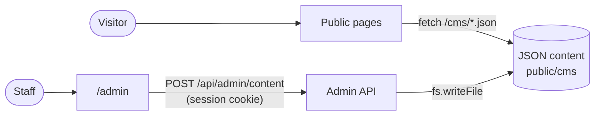

# Jugnu

[](https://github.com/Muddasirr/jugnu/actions/workflows/ci.yml)

Website for **The Jugnu Project**, a domestic-violence resource center in Pakistan. Survivors can find help quickly, the public can read data and legal updates, and staff can update content without a developer.

**Live:** https://jugnu-nu.vercel.app

## Why I built it

The organisation needed one place for help lines, survivor resources, femicide data, legal updates and their podcast. Most of that changes often, and the staff who update it aren't developers, so the site needed a simple admin panel rather than code changes for every edit.

## Features

- **About 25 pages:** get help, resources, survivor stories, training, volunteering, policy, podcasts, legal updates and corporate and social programmes.
- **Data pages:** femicide reports and "know the numbers", with interactive maps of Pakistan (Leaflet and react-simple-maps, drawn from GeoJSON boundaries).
- **Site-wide search** that jumps straight to the matching page.
- **Admin CMS at `/admin`:** staff log in and edit resources and PDFs, legal updates (Supreme Court, Federal Shariat Court, High Court, Constitutional Court), femicide data, impact stats, podcasts and news. Content is stored as JSON and read by the public pages.

## Tech stack

Next.js 15 (App Router), React 19, TypeScript, Tailwind CSS 4, Leaflet / react-leaflet, react-simple-maps, Embla carousel. Deployed on Vercel.



## Getting started

**Prerequisites:** Node 20.

```bash
npm install            # .npmrc sets legacy-peer-deps (react-simple-maps declares React ≤18)
cp .env.example .env.local
npm run dev            # http://localhost:3000
npm run build          # production build; CI runs this on every push and PR
```

| Variable | Purpose |
|---|---|
| `ADMIN_USER`, `ADMIN_PASS` | Admin login. If either is missing, admin login is disabled. |
| `ADMIN_SESSION_SECRET` | Signs the admin session cookie. Use a long random value (`openssl rand -base64 32`). |

## Challenges and what I learned

- **No default credentials.** The first version fell back to built-in admin credentials when env vars were missing, so a deployment without them was open to anyone who had read the repo. Now admin login is disabled unless all three variables are set.
- **Content as JSON files kept the CMS simple,** with no database to run. The trade-off is the storage problem below.

## Limitations and roadmap

- **Admin edits don't persist on Vercel.** The admin API writes JSON into `public/cms` on the server's filesystem, which Vercel doesn't keep between deployments. Next step: move content to a database or object storage (Supabase, Vercel Blob or a headless CMS).
- **The repo is about 250 MB,** mostly images and video in `public/`. They should move to a CDN or Git LFS, and be compressed.
- `react-simple-maps` doesn't declare React 19 support, hence `legacy-peer-deps`. It's only used by `src/components/map.tsx` (the Pakistan map section), which could switch to Leaflet like the other maps.
- There are no automated tests yet. CI checks that the site builds.

## License

Built for The Jugnu Project. All rights reserved.
